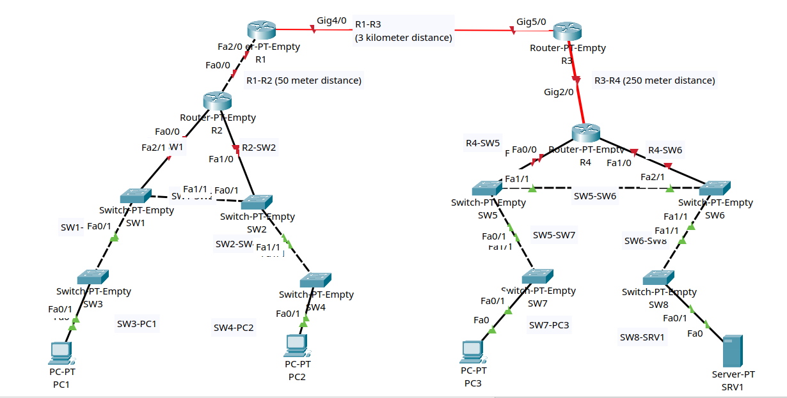

# Lab 01: Connecting Devices

**Tool used:** Cisco Packet Tracer

## 1. Objective

Connect routers, switches, PCs and a server using the correct cable and media type for every link. The right choice depends on which two device types are being joined and how far apart they are. This lab is about the physical layer only, so there is no IP addressing and no device configuration.

## 2. Topology

The topology has 16 devices joined by 17 links, split into two sites that are linked over a long-distance connection.

- Site A: routers R1 and R2, switches SW1 to SW4, and hosts PC1 and PC2.
- Site B: routers R3 and R4, switches SW5 to SW8, host PC3 and server SRV1.
- The two sites are joined by a 3 km link between R1 and R3. R3 and R4 sit 250 m apart.

## 3. Connections

There is no IP addressing in this lab, so this section lists how each part of the network is physically connected.

- R1 to R2 (50 m): copper crossover cable.
- R1 to R3 (3 km): single-mode fiber.
- R3 to R4 (250 m): multimode fiber.
- Router to switch (R2 to SW1 and SW2, R4 to SW5 and SW6): copper straight-through cable.
- Switch to switch (SW1 to SW2, SW1 to SW3, SW2 to SW4, SW5 to SW6, SW5 to SW7, SW6 to SW8): copper crossover cable.
- Switch to PC or server (SW3 to PC1, SW4 to PC2, SW7 to PC3, SW8 to SRV1): copper straight-through cable.

## 4. How the Cable Type Is Chosen

Copper straight-through or crossover:

- Routers, firewalls and PCs transmit on pins 1 and 2 and receive on pins 3 and 6.
- Switches transmit on pins 3 and 6 and receive on pins 1 and 2.
- A device's transmit pins must reach the other device's receive pins.
- Unlike devices, such as a router and a switch, line up correctly with a straight-through cable.
- Like devices, such as two switches or two routers, would have transmit meeting transmit, so a crossover cable is needed. It swaps pins 1 and 2 with pins 3 and 6.
- Most modern equipment supports Auto MDI-X, which detects the neighbour and corrects the pins automatically. The wrong copper cable often still works on real hardware, but I used the correct cable type for each link. In this Lab we are assuming Auto MDI-X is disabled.

Copper or fiber:

- UTP copper is limited to 100 m. It is the cheapest option but is vulnerable to EMI, and its signal can leak outside the cable.
- Multimode fiber reaches about 550 m at 1 Gbps (1000BASE-LX) and 400 m at 10 Gbps (10GBASE-SR). It uses cheaper LED-based optics.
- Single-mode fiber reaches 5 km at 1 Gbps (1000BASE-LX) and 10 km at 10 Gbps (10GBASE-LR). It uses laser-based optics, so it costs the most.

## 5. Design Decisions

- R1 to R2 is 50 m, which is inside the 100 m copper limit. Both are routers, so I used a crossover cable.
- R1 to R3 is 3 km. That is far beyond what copper or multimode fiber can cover, so single-mode fiber is the only fit.
- R3 to R4 is 250 m. That is too long for copper but within multimode range, so I chose multimode fiber, which is cheaper than single-mode.
- Every router-to-switch and switch-to-end-device link joins two different device types, so these use straight-through cables.
- Every switch-to-switch link joins two of the same device type, so these use crossover cables.

## 6. Configuration

No configuration was applied. This lab covers physical connectivity only.

## 7. Verification

I checked each link from the link-status lights in Packet Tracer.

- The ports on the switches and end devices show green, which means the link is up and the cable type is accepted.
- The router ports show red. Router interfaces are shut down by default and this lab applies no configuration, so red is expected here. The interfaces come up once `no shutdown` is applied in the later labs.

## 8. Troubleshooting

- While connecting the multi mode fiber cable between R1 and R2 there occured an issue I can't connect the cable between them, then I researched about the issue occured and I understood that there is a separate module for the single-mode fiber cable.
- Then I added PT-ROUTER-NM-1FGE-SM Module to the router by turning it off, I added this module in both R1 and R3, and then it was able to connect between two routers

## 9. Key Learnings

- The copper cable type depends on the pair of devices: different device types use straight-through, and the same device type uses crossover.
- Distance decides the media: copper up to 100 m, multimode fiber for medium runs, and single-mode fiber for long runs.
- Fiber optics cost more, so the cheapest option that covers the distance is the right choice.

## 10. Result

- Lab implemented successfully.
