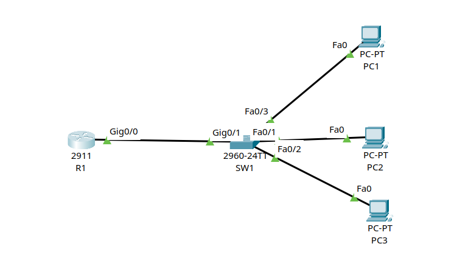

# Lab 02: Working with the CLI and Basic Device Security

**Tool:** Cisco Packet Tracer

## 1. Objective

Get comfortable with the Cisco IOS command-line interface on a router and a switch: moving between the CLI modes, naming the devices, protecting privileged mode with passwords, and saving and checking the configuration. No IP addressing, routing or switching features are configured. The lab is about the CLI and basic device security only.

## 2. Topology



The topology has one router (R1, Cisco 2911), one switch (SW1, Cisco 2960-24TT) and three PCs. R1 connects to SW1, and the three PCs connect to SW1. All CLI work was done on R1 and SW1. The PCs are only there to complete the topology.

## 3. Connections

There is no IP addressing in this lab, so this section lists the physical connections instead.

- R1 Gig0/0 to SW1 Gig0/1
- SW1 Fa0/1 to PC2
- SW1 Fa0/2 to PC3
- SW1 Fa0/3 to PC1

All links are copper straight-through cables, because each one joins two different device types.

## 4. CLI Modes

- User EXEC mode: the prompt ends in `>`, for example `Router>`. It is very limited. I can look at some things but cannot change the configuration.
- Privileged EXEC mode: the prompt ends in `#`, for example `Router#`. I enter it with the `enable` command. It gives full access to view the configuration, restart the device and save the configuration.
- Global configuration mode: the prompt looks like `Router(config)#`. I enter it with `configure terminal` from privileged EXEC mode, and `exit` drops back a level.

I understand some useful CLI habits from this lab:

- `?` lists the commands available in the current mode, and a partial command followed by `?` lists the matching commands.
- The Tab key completes a partly typed command.
- `no` in front of a command removes it.
- `do` runs a privileged EXEC command from inside configuration mode, for example `do show running-config`.

## 5. Design Decisions

- I set the hostnames to R1 and SW1 so the prompt shows which device I am working on.
- `enable password` protects privileged EXEC mode, but it is stored in plain text in the configuration.
- `service password-encryption` encrypts the plain-text passwords, current and future, using Cisco's type 7 encryption. Type 7 is weak and easy to reverse, so it only keeps passwords from being read at a glance. Turning the service off later does not decrypt passwords that are already encrypted.
- `enable secret` is always stored encrypted, as a type 5 (MD5) hash, which is much stronger. If both an enable password and an enable secret are set, the secret takes precedence.
- The running-config is the active configuration and is lost on restart. The startup-config is loaded when the device boots. I saved the running-config to the startup-config so the changes survive a reload.

## 6. Configuration

The same steps were applied on the router and the switch. Only the hostname changes. The passwords are dummy lab values and are written as `<password>` here.

R1:

```
Router> enable
Router# configure terminal
Router(config)# hostname R1
R1(config)# enable password <password>
R1(config)# service password-encryption
R1(config)# enable secret <password>
R1(config)# do show running-config
R1(config)# exit
R1# write memory
```

SW1:

```
Switch> enable
Switch# configure terminal
Switch(config)# hostname SW1
SW1(config)# enable password <password>
SW1(config)# service password-encryption
SW1(config)# enable secret <password>
SW1(config)# do show running-config
SW1(config)# exit
SW1# write memory
```

`write`, `write memory` and `copy running-config startup-config` all save the configuration in the same way. The full configurations are in the `configs` folder.

## 7. Verification

- `show running-config` on both devices shows the new hostname and the `service password-encryption` line. The enable secret appears as a type 5 hash and the enable password appears as a type 7 hash, so neither is readable in plain text.
- Entering `enable` from user EXEC mode asks for a password, which shows privileged mode is protected.
- `show startup-config` after saving matches the running-config, which shows the changes will survive a restart.

The full output is in the `configs` and `verification` folders.


## 8. Key Learnings

- The CLI has three modes I worked in: user EXEC, privileged EXEC and global configuration, each with its own prompt.
- `enable secret` is the right choice over `enable password`, because it is always stored with a stronger encryption and overrides the plain password.
- `service password-encryption` only hides passwords with weak encryption. Turning it off does not decrypt the ones already encrypted.
- Changes live in the running-config until they are saved, so I always save with `write` after configuring.

## 9. References

- Cisco IOS configuration fundamentals documentation
