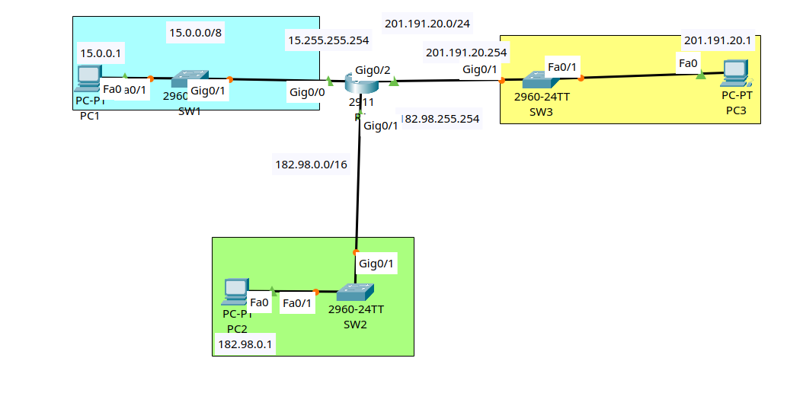

# Lab 03: IPv4 Addressing

**Tool:** Cisco Packet Tracer

## 1. Objective

Plan and assign IPv4 addresses for three separate networks joined by one router: a Class A, a Class B and a Class C network. For each network I worked out the network address, broadcast address, usable host range and maximum number of hosts, then configured the addresses on the router interfaces from the CLI and verified them. No routing protocols or static routes are configured. The lab is about addressing.

## 2. Topology



The topology has one router (R1, Cisco 2911), three switches (SW1 to SW3, Cisco 2960-24TT) and three PCs. Each switch and its PC form one LAN, and each LAN connects to its own interface on R1. In the image the LANs are shaded: blue for 15.0.0.0/8, green for 182.98.0.0/16 and yellow for 201.191.20.0/24.

Connections:

- R1 Gig0/0 to SW1 Gig0/1, and SW1 Fa0/1 to PC1
- R1 Gig0/1 to SW2 Gig0/1, and SW2 Fa0/1 to PC2
- R1 Gig0/2 to SW3 Gig0/1, and SW3 Fa0/1 to PC3

All links are copper straight-through cables, because each one joins two different device types.

## 3. Addressing

The three networks, with the addresses used in each:

Network 1: 15.0.0.0/8 (Class A), subnet mask 255.0.0.0

- Network address: 15.0.0.0
- Broadcast address: 15.255.255.255
- Usable range: 15.0.0.1 to 15.255.255.254
- Maximum hosts: 16,777,214
- R1 Gig0/0: 15.255.255.254
- PC1: 15.0.0.1

Network 2: 182.98.0.0/16 (Class B), subnet mask 255.255.0.0

- Network address: 182.98.0.0
- Broadcast address: 182.98.255.255
- Usable range: 182.98.0.1 to 182.98.255.254
- Maximum hosts: 65,534
- R1 Gig0/1: 182.98.255.254
- PC2: 182.98.0.1

Network 3: 201.191.20.0/24 (Class C), subnet mask 255.255.255.0

- Network address: 201.191.20.0
- Broadcast address: 201.191.20.255
- Usable range: 201.191.20.1 to 201.191.20.254
- Maximum hosts: 254
- R1 Gig0/2: 201.191.20.254
- PC3: 201.191.20.1

These addresses are used for practice inside Packet Tracer only. The lab is not connected to any real network.

## 4. Key Concepts

- An IPv4 address is 32 bits, split into four 8-bit octets and written in dotted decimal.
- The first octet decides the class: Class A is 1 to 126 (/8), Class B is 128 to 191 (/16) and Class C is 192 to 223 (/24). The 127 range is reserved for loopback.
- The prefix length is the number of bits in the network portion, and the subnet mask shows the same thing in dotted decimal.
- When the host bits are all 0 the address is the network address, and when they are all 1 it is the broadcast address. Neither can be given to a host.
- The number of hosts on a network is 2^N - 2, where N is the number of host bits.
- The first usable address is the network address plus 1, and the last usable address is the broadcast address minus 1.

## 5. Design Decisions

- A router separates networks and does not forward broadcasts, so each LAN is its own network on its own router interface. The switches only extend their own LAN.
- I used one network from each class so I could practise the /8, /16 and /24 masks.
- On every network the router takes the last usable address and the PC takes the first usable address. A consistent pattern makes the gateway address easy to recognise.
- Router interfaces are administratively down by default, so each used interface needs `no shutdown`. Switch ports are not shut down by default and the switches need no configuration.
- I added a description to each router interface so the output of the show commands says what each port connects to.

## 6. Configuration

R1:

```
Router> enable
Router# configure terminal
Router(config)# hostname R1
R1(config)# interface g0/0
R1(config-if)# description to SW1
R1(config-if)# ip address 15.255.255.254 255.0.0.0
R1(config-if)# no shutdown
R1(config-if)# interface g0/1
R1(config-if)# description to SW2
R1(config-if)# ip address 182.98.255.254 255.255.0.0
R1(config-if)# no shutdown
R1(config-if)# interface g0/2
R1(config-if)# description to SW3
R1(config-if)# ip address 201.191.20.254 255.255.255.0
R1(config-if)# no shutdown
R1(config-if)# end
R1# write memory
```

PCs: the IP address and subnet mask were set by hand on each PC under Desktop, then IP Configuration, using the addresses in section 3.

The full router configuration is in the `configs` folder.

## 7. Verification

- `show ip interface brief` on R1 lists the three Gigabit interfaces with the addresses 15.255.255.254, 182.98.255.254 and 201.191.20.254, the method `manual`, and status and protocol both `up`. This shows the addresses are applied and the interfaces are enabled.
- `show interfaces g0/0` shows the interface is up with the line protocol up, the Layer 3 address with its prefix length, and the MAC address of the port.
- `show interfaces description` lists each interface with the description I set.

The full output is in the `verification` folder.

## 8. Troubleshooting

**Scenario: PC1 could not ping its default gateway (15.255.255.254)**

After configuring R1 and PC1, a ping from PC1 to 15.255.255.254 failed.

- **Check 1:** On R1, `show ip interface brief` showed Gig0/0 as `up/up` with the correct address, so the interface itself was fine.
- **Check 2:** On PC1, `ipconfig` showed the address 15.0.0.1 with mask 255.0.0.0, but the default gateway was blank. I had set the IP and mask under Desktop > IP Configuration but had not filled in the gateway field.
- **Fix:** I set PC1's default gateway to 15.255.255.254 and re-ran the ping. It succeeded.
- **Lesson:** An interface being `up/up` on the router only proves the router side is configured. The PC still needs a gateway to reach another network, and `ipconfig` on the PC is the quickest way to confirm the host-side settings.

**Scenario: R1 Gig0/2 was down/down after configuration**

`show ip interface brief` showed Gig0/2 as `administratively down/down` even though I had entered the IP address.

- **Cause:** I had assigned the address but forgotten `no shutdown` on that interface. Router interfaces are shut down by default.
- **Fix:** I entered `interface g0/2` then `no shutdown`, and the status changed to `up/up`.
- **Lesson:** `show ip interface brief` separates status from protocol. `administratively down` means the interface is shut by configuration, not a cable or hardware fault, so the fix is `no shutdown`, not reseating cables.

## 9. Key Learnings

- The first octet of an address decides its class, and the class gives the default prefix length: /8, /16 or /24.
- The network address and the broadcast address cannot be assigned to hosts, so the usable range runs from the network address plus 1 to the broadcast address minus 1.
- The maximum number of hosts on a network is 2 to the power of the host bits, minus 2.
- A Cisco router interface stays down until it has an IP address and `no shutdown`. `show ip interface brief` is the quickest way to check this.

