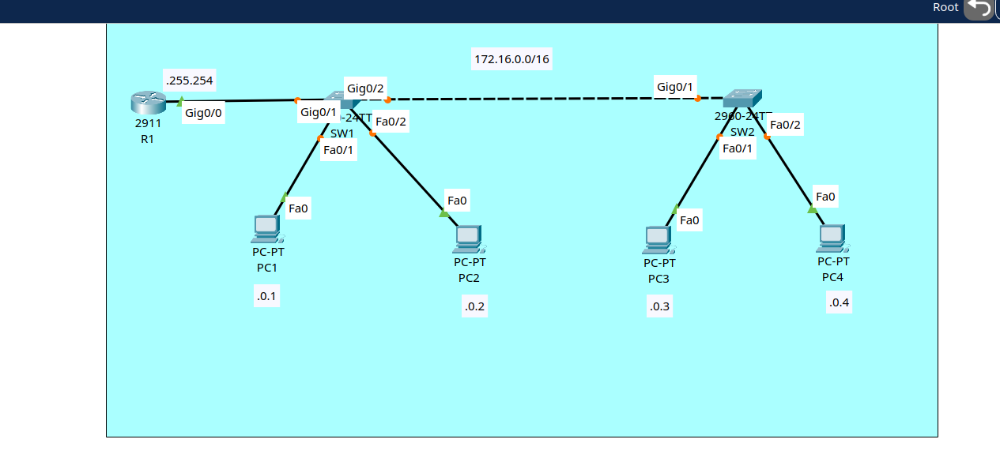

# Lab 04: Interface Configuration

**Tool:** Cisco Packet Tracer

## 1. Objective

Inspect and configure the interfaces of a Cisco switch: check interface status, set the speed and duplex by hand, add descriptions, and shut down unused ports with `interface range`. I also looked at the interface counters and error statistics. SW1 is the main device in this lab. R1 and SW2 were configured with only the basics. The lab is about interface settings only. No routing or VLANs are configured.

## 2. Topology



The topology has one router (R1, Cisco 2911), two switches (SW1 and SW2, Cisco 2960-24TT) and four PCs, all in one network, 172.16.0.0/16.

Connections:

- R1 Gig0/0 to SW1 Gig0/1
- SW1 Gig0/2 to SW2 Gig0/1 (crossover cable, shown dashed)
- SW1 Fa0/1 to PC1
- SW1 Fa0/2 to PC2
- SW2 Fa0/1 to PC3
- SW2 Fa0/2 to PC4

The links between end devices and switches are copper straight-through cables. The switch-to-switch link is a crossover cable, because both ends are the same device type.

## 3. Addressing

All devices share one network, 172.16.0.0/16, with subnet mask 255.255.0.0.

- R1 Gig0/0: 172.16.255.254
- PC1: 172.16.0.1
- PC2: 172.16.0.2
- PC3: 172.16.0.3
- PC4: 172.16.0.4

These addresses are used for practice inside Packet Tracer only.

## 4. Key Concepts

- Router interfaces are administratively down by default. Switch interfaces are not shut down by default, so a connected port comes up on its own, and an unconnected port shows `down`.
- On a switch, `show ip interface brief` and `show interfaces status` show the state of each port. The status output also lists the description, VLAN, duplex, speed and port type.
- Speed and duplex are set to `auto` by default. The two ends advertise what they support and agree on the best speed and duplex both can use. In the status output, `a-full` and `a-100` mean the values were negotiated automatically.
- Half duplex means a device cannot send and receive at the same time. Hubs used half duplex and shared one collision domain, and Ethernet used CSMA/CD to deal with collisions. Switches support full duplex, so every switch port is its own collision domain.
- A duplex mismatch, for example one side forced to full and the other negotiating to half, causes collisions and errors. Auto-negotiation should be used on all interfaces unless there is a reason not to.
- Interface counters in `show interfaces` show errors: runts (frames under the 64-byte minimum), giants (frames over the maximum size), CRC errors (frames that failed the checksum), frame errors, input errors and output errors.
- `interface range` applies one configuration to several interfaces at once.

## 5. Design Decisions

- I added a description to each used interface, so `show interfaces status` says what each port connects to.
- I shut down the unused ports, because an unused port that is left active is a security risk. I used `interface range` so I did not have to configure each port one at a time.
- I set speed and duplex by hand on one interface to practise the commands. In normal use, auto-negotiation is the better choice, so I kept every other port on auto.

## 6. Configuration

SW1:

```
Switch> enable
Switch# configure terminal
Switch(config)# hostname SW1
SW1(config)# interface fa0/1
SW1(config-if)# speed 100
SW1(config-if)# duplex full
SW1(config-if)# description ## to PC1 ##
SW1(config-if)# interface fa0/2
SW1(config-if)# description ## to PC2 ##
SW1(config-if)# interface g0/1
SW1(config-if)# description ## to R1 ##
SW1(config-if)# interface g0/2
SW1(config-if)# description ## to SW2 ##
SW1(config-if)# exit
SW1(config)# interface range fa0/3 - 24
SW1(config-if-range)# description ## not in use ##
SW1(config-if-range)# shutdown
SW1(config-if-range)# end
SW1# write memory
```

R1:

```
Router> enable
Router# configure terminal
Router(config)# hostname R1
R1(config)# interface g0/0
R1(config-if)# ip address 172.16.255.254 255.255.0.0
R1(config-if)# no shutdown
R1(config-if)# end
R1# write memory
```

SW2:

```
Switch> enable
Switch# configure terminal
Switch(config)# hostname SW2
SW2(config)# interface g0/1
SW2(config-if)# description ## to SW1 ##
SW2(config-if)# interface fa0/1
SW2(config-if)# description ## to PC3 ##
SW2(config-if)# interface fa0/2
SW2(config-if)# description ## to PC4 ##
SW2(config-if)# end
SW2# write memory
```

PCs: the IP address and subnet mask were set on each PC under Desktop, then IP Configuration, using the addresses in section 3.

The full SW1 configuration is in the `configs` folder.

## 7. Verification

- `show ip interface brief` on SW1 lists the interfaces. The connected ports show `up` and `up`, and the shut down ports show administratively down.
- `show interfaces status` lists the description, status, VLAN, duplex, speed and type of each port. The used ports show `connected` and the shut down ports show `disabled` with the description `## not in use ##`.
- `show interfaces fa0/1` shows the interface status, the description, the duplex and speed setting, and the packet counters and error counters (runts, giants, CRC, input errors and output errors).
- `show ip interface brief` on R1 shows Gig0/0 with the address 172.16.255.254, the method `manual`, and status and protocol both `up`.
- `show interfaces status` on SW2 lists its ports, with Gig0/1, Fa0/1 and Fa0/2 shown as `connected` and the rest as `notconnect`.

The full output is in the `verification` folder.

## 8. Troubleshooting

**Scenario 1: PC3 could not reach PC1, but the link light was green**

After cabling the lab, a ping from PC3 to PC1 failed even though the SW2 Fa0/1 port for PC3 showed a green link light.

- **Check 1:** On SW1, `show interfaces status` showed Fa0/2 (PC2) as `connected`, but Fa0/1 (PC1) was `notconnect`. So the problem was on the PC1 side, not between the switches.
- **Check 2:** PC1's cable was plugged into the wrong switch port — it was in Fa0/3 instead of Fa0/1. The port I had documented was empty.
- **Fix:** I moved the cable to Fa0/1. `show interfaces status` then showed Fa0/1 as `connected`, and the ping from PC3 to PC1 succeeded.
- **Lesson:** A green link light only proves the cable and the port are alive at Layer 1. `show interfaces status` on the switch confirms which port is actually connected, and comparing that against the documented wiring is the quickest way to spot a mis-plugged cable.

**Scenario 2: SW1 Gig0/2 showed a duplex mismatch warning**

After connecting SW1 to SW2 with a crossover cable, `show interfaces Gig0/2` on SW1 showed late collisions and FCS errors, and the log showed a duplex mismatch warning.

- **Cause:** SW1 Gig0/2 was left on `auto`, but SW2 Gig0/1 had been forced to `speed 100` and `duplex full`. One side was negotiating and the other was fixed, so the two ends agreed on speed but not on duplex.
- **Fix:** I set both ends the same way — `speed 100` and `duplex full` on SW1 Gig0/2 and SW2 Gig0/1 — so neither side was negotiating. The collision and error counters stopped climbing.
- **Lesson:** Speed and duplex should be set the same way on both ends of a link. If one end is forced and the other is `auto`, the auto end can fall back to half duplex, which causes collisions and errors even though the link is up.

## 9. Key Learnings

- Switch ports are enabled by default, unlike router interfaces, so unused ports should be shut down on purpose.
- `interface range` saves a lot of time when the same setting is needed on many ports.
- Speed and duplex should stay on auto. A forced setting on only one side can cause a duplex mismatch and collisions.
- A switch gives every port its own collision domain, so full duplex works and CSMA/CD is rarely needed.
- `show interfaces status` gives the quickest overview of a switch, and `show interfaces` gives the error counters for one port.

## 10. Result
Lab implemented successfully.
