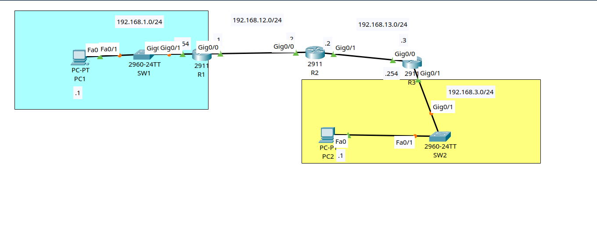

# Lab 05: Static Routing

**Tool:** Cisco Packet Tracer

## 1. Objective

Connect three LANs through a chain of three routers and make every network reachable by configuring static routes. I assigned IP addresses to the router interfaces and the PCs, set the default gateway on each PC, wrote static routes on each router, and tested end-to-end connectivity from PC1 to PC2. No dynamic routing protocol is used. The lab is about static routing only.

## 2. Topology



The topology has three routers (R1, R2 and R3, Cisco 2911), two switches (SW1 and SW2, Cisco 2960-24TT) and two PCs. R1, R2 and R3 are connected in a line, and each end router has a LAN behind it. In the image, the LAN behind R1 is shaded blue and the LAN behind R3 is shaded yellow.

Connections:

- PC1 Fa0 to SW1 Fa0/1
- SW1 Gig0/1 to R1 Gig0/1
- R1 Gig0/0 to R2 Gig0/0
- R2 Gig0/1 to R3 Gig0/0
- R3 Gig0/1 to SW2 Gig0/1
- SW2 Fa0/1 to PC2 Fa0

All links are copper. Links between different device types use straight-through cables, and the router-to-router links use crossover cables.

## 3. Addressing

| Device | Interface | IP address | Mask |
|---|---|---|---|
| R1 | Gig0/1 | 192.168.1.254 | 255.255.255.0 |
| R1 | Gig0/0 | 192.168.12.1 | 255.255.255.0 |
| R2 | Gig0/0 | 192.168.12.2 | 255.255.255.0 |
| R2 | Gig0/1 | 192.168.13.2 | 255.255.255.0 |
| R3 | Gig0/0 | 192.168.13.3 | 255.255.255.0 |
| R3 | Gig0/1 | 192.168.3.254 | 255.255.255.0 |
| PC1 | Fa0 | 192.168.1.1 | 255.255.255.0 |
| PC2 | Fa0 | 192.168.3.1 | 255.255.255.0 |

Networks:

- 192.168.1.0/24: LAN behind R1 (PC1)
- 192.168.12.0/24: link between R1 and R2
- 192.168.13.0/24: link between R2 and R3
- 192.168.3.0/24: LAN behind R3 (PC2)

Default gateways: PC1 uses 192.168.1.254 and PC2 uses 192.168.3.254.

These addresses are used for practice inside Packet Tracer only.

## 4. Key Concepts

- Routing is how a router decides where to send an IP packet. A router keeps the routes it knows in a routing table and looks there for the best match for each packet.
- Routes are learned in two ways. Dynamic routing uses a protocol such as OSPF, EIGRP or RIP. Static routing means an administrator enters the routes by hand.
- When an interface has an IP address and is up, the router adds two routes automatically. A connected route (`C`) covers the whole network, and a local route (`L`) covers the router's own address as a /32.
- A router only knows its directly connected networks. Every other network needs a route, or packets for it are dropped.
- A static route (`S`) tells the router that to reach a destination network, it should forward the packet to a next-hop, which is the next router on the path. The syntax is `ip route <network> <mask> <next-hop>`.
- A default route is `0.0.0.0/0`. It matches every destination, so it is only used when no more specific route exists.
- When more than one route matches a packet, the router uses the most specific one, which is the one with the longest prefix length.
- A PC needs a default gateway, the router address on its own LAN, to send traffic to other networks.
- Routing must work in both directions. A ping fails if the reply has no route back, even when the request got through.

## 5. Design Decisions

- Each router needs a route to every network that is not directly connected, so every router has two static routes.
- I used the next-hop form for the routes, because it names the neighbouring router clearly and works well on links between routers.
- I used the last usable address on each LAN for the router, and the first usable addresses for the PCs, so the gateway is easy to recognise.
- The switches have no configuration. They only extend each LAN at Layer 2.

## 6. Configuration

R1:

```
Router> enable
Router# configure terminal
Router(config)# hostname R1
R1(config)# interface g0/0
R1(config-if)# ip address 192.168.12.1 255.255.255.0
R1(config-if)# no shutdown
R1(config-if)# interface g0/1
R1(config-if)# ip address 192.168.1.254 255.255.255.0
R1(config-if)# no shutdown
R1(config-if)# exit
R1(config)# ip route 192.168.13.0 255.255.255.0 192.168.12.2
R1(config)# ip route 192.168.3.0 255.255.255.0 192.168.12.2
R1(config)# end
R1# write memory
```

R2:

```
Router> enable
Router# configure terminal
Router(config)# hostname R2
R2(config)# interface g0/0
R2(config-if)# ip address 192.168.12.2 255.255.255.0
R2(config-if)# no shutdown
R2(config-if)# interface g0/1
R2(config-if)# ip address 192.168.13.2 255.255.255.0
R2(config-if)# no shutdown
R2(config-if)# exit
R2(config)# ip route 192.168.1.0 255.255.255.0 192.168.12.1
R2(config)# ip route 192.168.3.0 255.255.255.0 192.168.13.3
R2(config)# end
R2# write memory
```

R3:

```
Router> enable
Router# configure terminal
Router(config)# hostname R3
R3(config)# interface g0/0
R3(config-if)# ip address 192.168.13.3 255.255.255.0
R3(config-if)# no shutdown
R3(config-if)# interface g0/1
R3(config-if)# ip address 192.168.3.254 255.255.255.0
R3(config-if)# no shutdown
R3(config-if)# exit
R3(config)# ip route 192.168.1.0 255.255.255.0 192.168.13.2
R3(config)# ip route 192.168.12.0 255.255.255.0 192.168.13.2
R3(config)# end
R3# write memory
```

PCs: the IP address, subnet mask and default gateway were set on each PC under Desktop, then IP Configuration, using the values in section 3.

The full router configurations are in the `configs` folder.

## 7. Verification

- `show ip interface brief` on each router lists both interfaces with the correct addresses, the method `manual`, and status and protocol both `up`.
- `show ip route` on each router shows a `C` and an `L` route for each connected network, plus an `S` route for each static route, for example `S 192.168.3.0/24 [1/0] via 192.168.12.2` on R1. The `[1/0]` means an administrative distance of 1 and a metric of 0.
- `ping 192.168.3.1` from PC1 succeeds, which shows packets reach PC2 and the replies find their way back.
- `tracert 192.168.3.1` from PC1 lists the hops through R1, R2 and R3.

The router output is in the `verification` folder, and the ping test is saved as a screenshot there.

## 8. Troubleshooting

**Scenario: PC1 could ping R1's LAN interface but not PC2**

After configuring R1 and R2 and the PCs, a ping from PC1 (192.168.1.1) to PC2 (192.168.3.1) failed. A ping from PC1 to R1's LAN address (192.168.1.254) succeeded, so PC1's own gateway and cable were fine.

- **Check 1:** `show ip route` on R1 showed `S 192.168.13.0/24 via 192.168.12.2` and `S 192.168.3.0/24 via 192.168.12.2`, so R1 knew where to send the request.
- **Check 2:** `show ip route` on R2 showed the route to 192.168.3.0/24 via 192.168.13.3, so the request could reach R3. `show ip route` on R3 was the problem: it had a route to 192.168.1.0/24 via 192.168.13.2, but **no route back to 192.168.12.0/24**, the R2–R3 link. R3 could not even reply to R2.
- **Check 3:** `debug ip icmp` on R3 showed the echo request arriving and R3 having no route to the source, so the request was dropped on the way back.
- **Fix:** I added `ip route 192.168.12.0 255.255.255.0 192.168.13.2` on R3. The ping from PC1 to PC2 then succeeded, and `tracert` from PC1 listed R1, R2 and R3.
- **Lesson:** Static routing has to be symmetric. A router only needs a route to the destination to forward the request, but the reply needs a route back to the source, and a missing return route on any router in the path breaks the whole exchange. In production this is the most common static-routing fault, and `show ip route` on every hop, not just the first one, is how you find it.

## 9. Key Learnings

- A router only has routes for its connected networks until I add more, so every router in the path needs a route to every remote network.
- `show ip route` is the first command to check. Connected and local routes appear on their own, and static routes appear with the code `S`.
- A static route needs a next-hop that is directly reachable, so the interface toward it must be up first.
- Routes have to exist in both directions, because the reply packet needs a way back.
- A PC without the right default gateway cannot leave its own LAN, even when the routers are configured correctly.

## 10. Result
Lab implemented successfully

