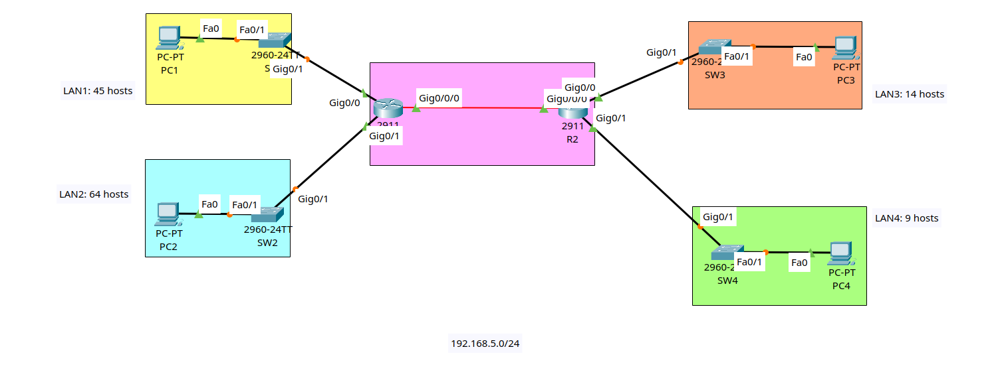

# Lab 06: VLSM Subnetting

**Tool:** Cisco Packet Tracer

## 1. Objective

Divide the network 192.168.5.0/24 into subnets of different sizes using VLSM (variable-length subnet masks), so each LAN gets a subnet that fits its number of hosts. For each subnet I worked out the network address, broadcast address, usable range, number of usable hosts and subnet mask by hand. I then configured the addresses on two routers, added static routes so every subnet can reach every other one, and tested connectivity between the PCs.

## 2. Topology



The topology has two routers (R1 and R2, Cisco 2911), four switches (SW1 to SW4, Cisco 2960-24TT) and four PCs. Each switch and its PC form one LAN, and the two routers are connected directly to each other.

Connections:

- R1 Gig0/0 to SW1 Gig0/1, and SW1 Fa0/1 to PC1 (LAN1, 45 hosts)
- R1 Gig0/1 to SW2 Gig0/1, and SW2 Fa0/1 to PC2 (LAN2, 64 hosts)
- R2 Gig0/0 to SW3 Gig0/1, and SW3 Fa0/1 to PC3 (LAN3, 14 hosts)
- R2 Gig0/1 to SW4 Gig0/1, and SW4 Fa0/1 to PC4 (LAN4, 9 hosts)
- R1 Gig0/0/0 to R2 Gig0/0/0 (point-to-point link between the routers)

The links between routers and switches, and between switches and PCs, are copper straight-through cables.

## 3. Addressing

The starting network is 192.168.5.0/24. Subnets are assigned from the largest to the smallest.

| Network | Hosts needed | Network address | Mask | Broadcast | Usable range | Usable hosts |
|---|---|---|---|---|---|---|
| LAN2 | 64 | 192.168.5.0/25 | 255.255.255.128 | 192.168.5.127 | 192.168.5.1 to 192.168.5.126 | 126 |
| LAN1 | 45 | 192.168.5.128/26 | 255.255.255.192 | 192.168.5.191 | 192.168.5.129 to 192.168.5.190 | 62 |
| LAN3 | 14 | 192.168.5.192/28 | 255.255.255.240 | 192.168.5.207 | 192.168.5.193 to 192.168.5.206 | 14 |
| LAN4 | 9 | 192.168.5.208/28 | 255.255.255.240 | 192.168.5.223 | 192.168.5.209 to 192.168.5.222 | 14 |
| R1 to R2 link | 2 | 192.168.5.224/30 | 255.255.255.252 | 192.168.5.227 | 192.168.5.225 to 192.168.5.226 | 2 |

Device addresses:

| Device | Interface | IP address | Mask |
|---|---|---|---|
| R1 | Gig0/0 | 192.168.5.190 | 255.255.255.192 |
| R1 | Gig0/1 | 192.168.5.126 | 255.255.255.128 |
| R1 | Gig0/0/0 | 192.168.5.225 | 255.255.255.252 |
| R2 | Gig0/0/0 | 192.168.5.226 | 255.255.255.252 |
| R2 | Gig0/0 | 192.168.5.206 | 255.255.255.240 |
| R2 | Gig0/1 | 192.168.5.222 | 255.255.255.240 |
| PC1 | Fa0 | 192.168.5.129 | 255.255.255.192 |
| PC2 | Fa0 | 192.168.5.1 | 255.255.255.128 |
| PC3 | Fa0 | 192.168.5.193 | 255.255.255.240 |
| PC4 | Fa0 | 192.168.5.209 | 255.255.255.240 |

Default gateways: each PC uses the address of the router interface on its own LAN (PC1 192.168.5.190, PC2 192.168.5.126, PC3 192.168.5.206, PC4 192.168.5.222).

The addresses from 192.168.5.228 to 192.168.5.255 are unused and left free for future subnets. These addresses are used for practice inside Packet Tracer only.

## 4. Key Concepts

- VLSM lets different subnets use different prefix lengths, so each one can be sized for the hosts it needs instead of wasting addresses.
- The number of usable hosts in a subnet is 2^N - 2, where N is the number of host bits. The network address and the broadcast address cannot be given to hosts.
- To pick a prefix, find the smallest power of two that holds the hosts plus those two reserved addresses. For example, 64 hosts need 66 addresses, so a /26 (64 addresses) is too small and a /25 (128 addresses) is needed.
- The subnet mask shows the network bits as 1s. /25 is 255.255.255.128, /26 is 255.255.255.192, /28 is 255.255.255.240 and /30 is 255.255.255.252.
- The block size of a subnet is the number of addresses in it. The next subnet starts right after the broadcast address of the previous one.
- To avoid overlap, subnets are assigned from the largest to the smallest.
- A point-to-point link between two routers needs only two usable addresses, so a /30 is the right fit.
- A router only knows its directly connected subnets. Static routes tell it how to reach the others, using the other router as the next-hop.

## 5. Design Decisions

- I started with the largest subnet and worked down, so the subnets sit one after another with no overlap.
- LAN2 needs 64 hosts, which does not fit in a /26, so it gets a /25 with 126 usable addresses.
- LAN3 and LAN4 both get a /28. A /28 gives 14 usable addresses, which covers 14 and 9 hosts.
- The link between the routers is a /30, because it only has two devices.
- Each router takes the last usable address of its LAN and the PCs take the first, so the gateway is easy to recognise.
- Each router has two static routes, one for each subnet behind the other router. The point-to-point subnet is directly connected to both routers, so it needs no route.
- The switches have no configuration. They only extend each LAN at Layer 2.

## 6. Configuration

R1:

```
Router> enable
Router# configure terminal
Router(config)# hostname R1
R1(config)# interface g0/0
R1(config-if)# ip address 192.168.5.190 255.255.255.192
R1(config-if)# no shutdown
R1(config-if)# interface g0/1
R1(config-if)# ip address 192.168.5.126 255.255.255.128
R1(config-if)# no shutdown
R1(config-if)# interface g0/0/0
R1(config-if)# ip address 192.168.5.225 255.255.255.252
R1(config-if)# no shutdown
R1(config-if)# exit
R1(config)# ip route 192.168.5.192 255.255.255.240 192.168.5.226
R1(config)# ip route 192.168.5.208 255.255.255.240 192.168.5.226
R1(config)# end
R1# write memory
```

R2:

```
Router> enable
Router# configure terminal
Router(config)# hostname R2
R2(config)# interface g0/0
R2(config-if)# ip address 192.168.5.206 255.255.255.240
R2(config-if)# no shutdown
R2(config-if)# interface g0/1
R2(config-if)# ip address 192.168.5.222 255.255.255.240
R2(config-if)# no shutdown
R2(config-if)# interface g0/0/0
R2(config-if)# ip address 192.168.5.226 255.255.255.252
R2(config-if)# no shutdown
R2(config-if)# exit
R2(config)# ip route 192.168.5.128 255.255.255.192 192.168.5.225
R2(config)# ip route 192.168.5.0 255.255.255.128 192.168.5.225
R2(config)# end
R2# write memory
```

PCs: the IP address, subnet mask and default gateway were set on each PC under Desktop, then IP Configuration, using the values in section 3.

The full router configurations are in the `configs` folder.

## 7. Verification

- `show ip interface brief` on each router lists its three interfaces with the correct addresses, the method `manual`, and status and protocol both `up`.
- `show ip route` on R1 shows connected routes for 192.168.5.128/26, 192.168.5.0/25 and 192.168.5.224/30, and two static routes for 192.168.5.192/28 and 192.168.5.208/28 via 192.168.5.226.
- `show ip route` on R2 shows connected routes for 192.168.5.192/28, 192.168.5.208/28 and 192.168.5.224/30, and two static routes for 192.168.5.128/26 and 192.168.5.0/25 via 192.168.5.225.
- `ping 192.168.5.193` from PC1 to PC3 succeeds, so traffic crosses both routers in both directions.
- `ping 192.168.5.209` from PC2 to PC4 succeeds.

The router output is in the `verification` folder, and the ping tests are saved there as screenshots.

## 8. Troubleshooting

**Scenario: PC3 could not reach PC1, and the cause was a mistyped static route**

After configuring both routers and all four PCs, a ping from PC3 (192.168.5.193) to PC1 (192.168.5.129) failed.

- **Check 1:** On PC3, `ipconfig` showed 192.168.5.193/28 with gateway 192.168.5.206, which matched section 3, so the PC side was correct.
- **Check 2:** On R2, `show ip route` showed connected routes for 192.168.5.192/28, 192.168.5.208/28 and 192.168.5.224/30, plus a static route for 192.168.5.128/26 via 192.168.5.225 and one for 192.168.5.0/25 via 192.168.5.225. The routes looked right.
- **Check 3:** On R1, `show ip route` showed the connected routes, but only one static route — for 192.168.5.208/28 via 192.168.5.226. The route for **192.168.5.192/28 was missing**. When I looked at what I had typed, I had entered `ip route 192.168.5.192 255.255.255.252 192.168.5.226` — a /30 mask instead of the /28 the subnet actually uses. A /30 route to 192.168.5.192/30 is a different network from 192.168.5.192/28, so R1 never matched PC3's traffic.
- **Fix:** I removed the wrong route with `no ip route 192.168.5.192 255.255.255.252 192.168.5.226` and added the correct one with `ip route 192.168.5.192 255.255.255.240 192.168.5.226`. The ping from PC3 to PC1 then succeeded.
- **Lesson:** In VLSM, the mask on a static route must match the subnet exactly. A wrong mask does not produce an error — the route is accepted and just never matches the traffic it was meant for, which makes it a silent failure. `show ip route` is where you catch it, and comparing every route's mask against the addressing table, not just the network address, is the check that finds it.


## 9. Key Learnings

- With VLSM, each subnet is sized for its own hosts, so the /24 holds five subnets of four different sizes and still leaves space free.
- The host count needs room for the network and broadcast addresses, which is why 64 hosts need a /25 and not a /26.
- Assigning subnets from the largest to the smallest keeps them in order and prevents overlap.
- A /30 is the right size for a link between two routers.
- Every router needs a route to each subnet it is not directly connected to, and the routes must exist in both directions for a ping to succeed.

## 10. Result
Lab Implemented successfully

