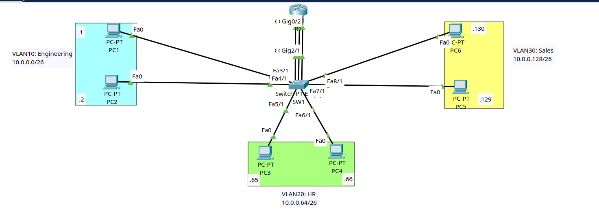

# Lab 07: VLANs and Access Ports

**Tool:** Cisco Packet Tracer

## 1. Objective

Split one switch into three separate VLANs, one for each department, so that each department is its own broadcast domain. I created the VLANs, named them and assigned the switch ports to them as access ports, then checked the result with `show vlan brief`. The lab covers VLANs and access ports only. Trunking is not part of it.

## 2. Topology



The topology has one switch (SW1), one router (R1) and six PCs. The PCs connect to SW1 and are grouped by department. R1 connects to SW1 with one link for each VLAN, so a router is available for routing between the VLANs. In the image the departments are shaded: blue for Engineering, green for HR and yellow for Sales.

## 3. Addressing

The 10.0.0.0 network is split into three /26 subnets, one for each VLAN. The subnet mask for all three is 255.255.255.192. Each /26 has 64 addresses, of which 62 can be given to hosts.

VLAN 10, Engineering: 10.0.0.0/26

- Usable range: 10.0.0.1 to 10.0.0.62
- Broadcast address: 10.0.0.63
- PC1: 10.0.0.1
- PC2: 10.0.0.2

VLAN 20, HR: 10.0.0.64/26

- Usable range: 10.0.0.65 to 10.0.0.126
- Broadcast address: 10.0.0.127
- PC3: 10.0.0.65
- PC4: 10.0.0.66

VLAN 30, Sales: 10.0.0.128/26

- Usable range: 10.0.0.129 to 10.0.0.190
- Broadcast address: 10.0.0.191
- PC5: 10.0.0.129
- PC6: 10.0.0.130

Port assignments on SW1:

- PC1 and PC2 are on Fa3/1 and Fa4/1, in VLAN 10.
- PC3 and PC4 are on Fa5/1 and Fa6/1, in VLAN 20.
- PC5 and PC6 are on Fa7/1 and Fa8/1, in VLAN 30.

## 4. Key Concepts

- A LAN is a single broadcast domain. A broadcast frame (destination MAC FFFF.FFFF.FFFF) reaches every device in it.
- A VLAN logically separates end hosts at Layer 2. VLANs are configured on a Layer 2 switch, port by port, and the switch treats each VLAN as its own LAN.
- An access port belongs to a single VLAN and usually connects to an end host such as a PC. Ports that carry several VLANs are trunk ports, which are a later topic.
- A switch does not forward traffic between VLANs, including broadcast and unknown unicast traffic. A router or a Layer 3 switch is needed to send traffic from one VLAN to another.
- VLAN 1 and VLANs 1002 to 1005 exist by default and cannot be deleted.
- VLANs reduce unnecessary broadcast traffic, which improves performance, and they improve security because messages do not reach devices outside the VLAN.

## 5. Design Decisions

- I used three VLANs, one per department, so Engineering, HR and Sales each get their own broadcast domain.
- I gave each VLAN its own /26 subnet, so every VLAN is also its own IP network and the VLAN number matches the addressing plan.
- The PC ports are access ports, because each one connects a single end host that belongs to a single VLAN.
- I gave the VLANs names, so the output of `show vlan brief` shows the department and not only a number.
- Traffic between departments has to pass through the router. The switch alone keeps the VLANs apart.

## 6. Configuration

SW1:

```
Switch> enable
Switch# configure terminal
Switch(config)# hostname SW1
SW1(config)# vlan 10
SW1(config-vlan)# name Engineering
SW1(config-vlan)# vlan 20
SW1(config-vlan)# name HR
SW1(config-vlan)# vlan 30
SW1(config-vlan)# name Sales
SW1(config-vlan)# interface range fa3/1, fa4/1
SW1(config-if-range)# switchport mode access
SW1(config-if-range)# switchport access vlan 10
SW1(config-if-range)# interface range fa5/1, fa6/1
SW1(config-if-range)# switchport mode access
SW1(config-if-range)# switchport access vlan 20
SW1(config-if-range)# interface range fa7/1, fa8/1
SW1(config-if-range)# switchport mode access
SW1(config-if-range)# switchport access vlan 30
SW1(config-if-range)# end
SW1# write memory
```

The PCs have the IP addresses from section 3 and the subnet mask 255.255.255.192, set under Desktop, then IP Configuration. The full configurations of SW1 and R1 are in the `configs` folder.

## 7. Verification

- `show vlan brief` on SW1 lists VLAN 10 Engineering, VLAN 20 HR and VLAN 30 Sales as active, each with the ports assigned to it. This shows the VLANs exist and the ports are in the right VLANs.
- The default VLAN 1 and VLANs 1002 to 1005 are also listed, as expected.
- A ping from PC1 to PC2, both in VLAN 10, succeeds. Devices in the same VLAN can reach each other.
- A ping from PC1 to PC3, which is in VLAN 20, succeeds only because the traffic is routed through R1. The switch alone does not forward traffic between VLANs.


The full output is in the `verification` folder.

## 8. Troubleshooting

**Scenario 1: PC4 could not ping PC3 even though both were in HR**

PC3 and PC4 are both in VLAN 20, on the same switch. A ping from PC4 to PC3 failed. That surprised me, because two PCs in the same VLAN should talk to each other through the switch without a router.

- First I checked the PCs. `ipconfig` on PC4 showed 10.0.0.66 with mask 255.255.255.192, and PC3 showed 10.0.0.65 with the same mask. Both correct, same subnet.
- Then I ran `show vlan brief` on SW1. VLAN 20 HR listed Fa5/1 but not Fa6/1. Fa6/1 was sitting in VLAN 1, the default. I had typed `fa6/1` in the `interface range` for VLAN 20, but the port never took it. Looking back at the config, the range command had taken `fa5/1` only, so Fa6/1 kept its default VLAN.
- I went into `interface fa6/1`, set `switchport mode access` and `switchport access vlan 20`, and the ping worked straight away.
- The lesson for me: same VLAN is not the same as same subnet. A port left in VLAN 1 looks fine on the PC side and the cable light is green, so nothing points at the switch until you run `show vlan brief` and check every port by name.

**Scenario 2: a PC plugged into the wrong port joined the wrong department**

While tidying the lab I moved PC2 to a free port, Fa1/1. Its IP was still 10.0.0.2/26 and it could ping PC1 (10.0.0.1) fine, so I assumed it was still in Engineering. Then I tried a ping from PC2 to PC3 in HR and it failed, which was expected because there is no routing between VLANs yet. But when I checked `show vlan brief`, PC2's port Fa1/1 was in VLAN 1, not VLAN 10.

- Fa1/1 was a port I had never configured, so it was still in the default VLAN 1. The PC worked and could reach other hosts in VLAN 1, but it was not in the department VLAN I thought it was in.
- I set Fa1/1 to `switchport mode access` and `switchport access vlan 10` and the PC was back with Engineering.
- The lesson: a new port is not "unused", it is in VLAN 1 by default. In a real office, plugging a PC into a port nobody configured puts it in the default VLAN, which is often the management VLAN. That is a security problem as much as a connectivity one, so unused ports should be shut down or put in an unused VLAN.

## 9. Key Learnings

- A VLAN gives each department its own broadcast domain on the same switch, without needing a separate switch for each one.
- Assigning a port to a VLAN is done on the interface with `switchport mode access` and `switchport access vlan`, and `interface range` saves repeating the commands.
- The switch keeps VLANs apart. Traffic between VLANs needs a router or a Layer 3 switch.
- `show vlan brief` is the quickest way to check which ports belong to which VLAN.

## 10. Result
Lab Implemented successfully
